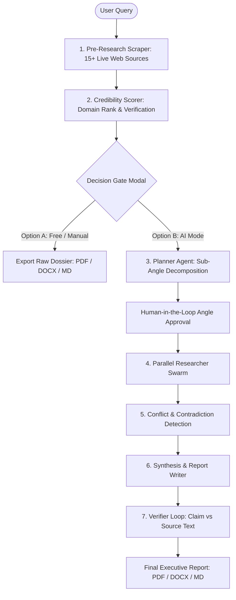

# 🌐 ResearchMate: Autonomous Deep Research Command Deck

[](https://www.python.org/)
[](https://fastapi.tiangolo.com/)
[](https://threejs.org/)
[](https://opensource.org/licenses/MIT)

> **ResearchMate** is an autonomous multi-agent research command center. It features an interactive **3D WebGL Command Deck**, **Zero-API live web scraping**, **hallucination-free fact verification**, multi-source credibility scoring, and multi-format document exports (**PDF, Word DOCX, and Markdown**).

---

## 📸 Overview & Key Highlights

- **⚡ Two-Stage Autonomous Flow (Decision Gate)**:
  1. **Stage 1 (100% Free / Zero API)**: Scrapes 15+ live web sources via parallel async workers with anti-bot rotation, calculates source credibility scores, and compiles an instant Raw Intelligence Dossier.
  2. **Stage 2 (Optional AI Synthesis)**: User decides whether to export raw intelligence directly (PDF/DOCX/MD) or invoke LLM agents to synthesize, cross-verify, and format an executive research report.
- **🎮 3D WebGL Command Deck**:
  Built with Three.js (no heavy Node.js build tools required). Features dynamic starfields, neural globe, live 3D agent swarm visualization, and seamless camera flights between deck views.
- **🛡️ Hallucination-Free Verifier Loop**:
  Every factual claim drafted by the writer is strictly cross-examined against raw cached webpage text. Unsupported claims are rejected or flagged with verifiable confidence ratios.
- **⚖️ Multi-Perspective Debate Mode**:
  Analyzes controversial topics by deploying PRO vs. CON agent researchers to deliver a balanced consensus verdict.
- **📄 Multi-Format Native Export**:
  Export dossiers and reports into publication-ready **PDF** (with proper UTF-8 shaping), **Word (.docx)**, or **Markdown (.md)**.

---

## 🏗️ Project Architecture

```
researchmate/
├── api.py                   # FastAPI REST backend & SSE real-time stream endpoints
├── run.py                   # One-click startup runner (launches server & browser)
├── requirements.txt         # Core dependencies
├── .env.example             # Template for API keys & configuration
├── .gitignore               # Clean gitignore excluding secrets, DBs, and bytecode
│
├── app/                     # Core Multi-Agent Logic & Utilities
│   ├── agents/              # Specialized Python AI Agents
│   │   ├── pre_research.py  # Zero-API parallel scraper & intelligence extractor
│   │   ├── planner.py       # Research decomposition & sub-question planner
│   │   ├── researcher.py    # Autonomous web researcher with anti-hallucination guard
│   │   ├── writer.py        # Report synthesis & citation chip generator
│   │   ├── verifier.py      # Claim verification against cached source text
│   │   ├── conflicts.py     # Contradiction & claim collision detector
│   │   └── debate.py        # Pro vs. Con debate orchestration
│   ├── graph.py             # LangGraph state machine & multi-agent execution pipeline
│   ├── scoring.py           # Mathematical source credibility engine (.gov/.edu/news vs social)
│   ├── tools.py             # Web search, page reader with header rotation & PDF RAG
│   ├── export.py            # PDF & Word DOCX generation engine
│   ├── llm.py               # Unified LLM client (Gemini, Claude, Groq)
│   ├── schemas.py           # Pydantic data schemas
│   └── storage.py           # SQLite local history and cache persistence
│
├── web/                     # 3D Command Deck Frontend (Vanilla ES Modules + Three.js)
│   ├── index.html           # Main command deck HTML
│   ├── js/                  # Frontend ES modules (3D Scene, API, Views, UI)
│   │   ├── app.js           # Main application state & view routing
│   │   ├── scene.js         # Three.js 3D globe, starfield, and agent nodes
│   │   └── api.js           # REST API client
│   └── css/                 # Glassmorphic cybernetic styling
│
├── evals/                   # Comprehensive evaluation benchmark suite
│   ├── full_eval.py         # Automated LLM-as-judge evaluation pipeline
│   └── queries.json         # Benchmark research queries across domains
│
└── data/                    # Local storage (SQLite, ChromaDB) [Ignored in git]
```

---

## 🚀 Quick Start Guide

### 1. Clone & Set Up Virtual Environment

```bash
# Clone the repository
git clone https://github.com/YOUR_USERNAME/ResearchMate.git
cd ResearchMate/researchmate

# Create and activate virtual environment
python -m venv venv

# Windows:
venv\Scripts\activate
# Linux/macOS:
source venv/bin/activate

# Install dependencies
pip install -r requirements.txt
```

### 2. Configure Environment Variables

```bash
# Copy example configuration
cp .env.example .env
```
Open `.env` in any editor and add your preferred LLM API key (e.g. `GEMINI_API_KEY`).  
*(Note: You can explore and test the entire Pre-Research & Scraper pipeline even without an API key!)*

### 3. Launch ResearchMate

Simply run:
```bash
python run.py
```
This automatically initializes the FastAPI server and opens your browser at:
- **Command Deck:** `http://localhost:8000`
- **Instant 3D Demo:** `http://localhost:8000/?demo=1`

---

## 📊 How It Works (Step-by-Step)



---

## 📜 License
Distributed under the **MIT License**. See `LICENSE` for details.
